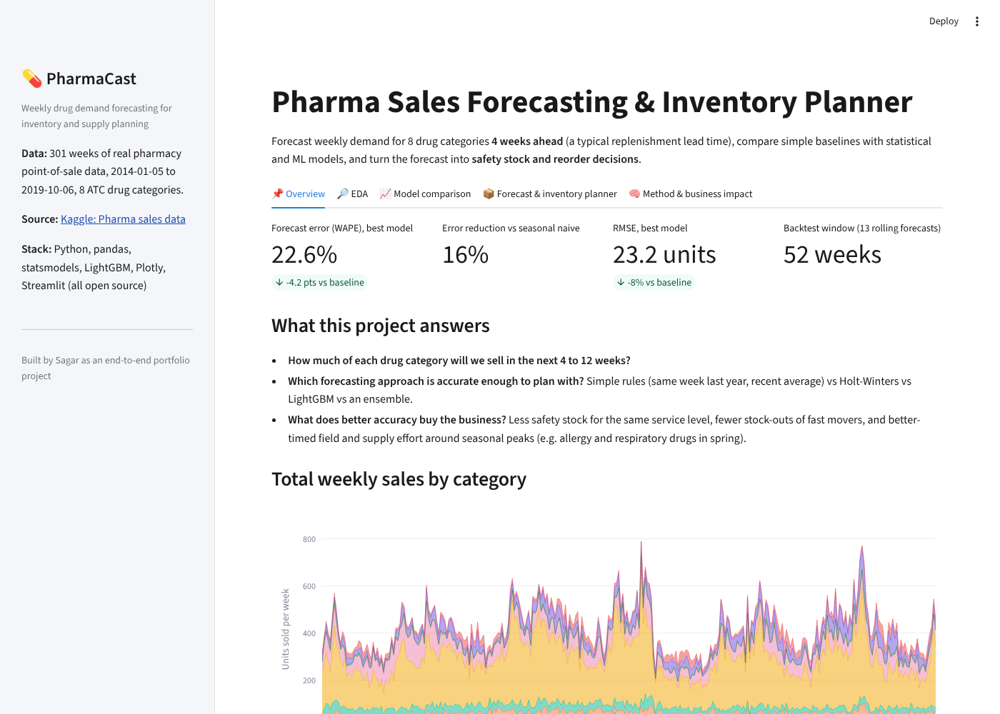
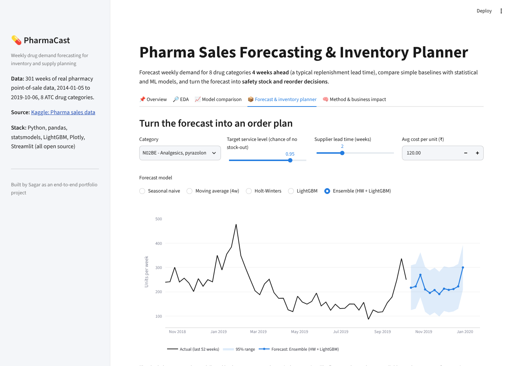

# 💊 PharmaCast: Pharma Sales Forecasting & Inventory Planner

**Live demo:** `<paste your Streamlit link here>`

An end-to-end data science project that forecasts weekly demand for 8 drug categories,
compares simple baselines with statistical and machine-learning models, and turns the forecast
into **safety stock and reorder decisions**. Built only with free, open-source tools.



## Business problem

Pharmacies, distributors and pharma supply teams must order stock **before** demand happens.

- Order too little → stock-outs, lost patients, lost revenue.
- Order too much → expired stock and cash locked in inventory.

The decision is made about **4 weeks ahead** (a typical replenishment lead time), so we need an
accurate 4-week forecast and an honest measure of its error.

## Data

[Pharma sales data (Kaggle)](https://www.kaggle.com/datasets/milanzdravkovic/pharma-sales-data):
real point-of-sale data from one pharmacy, about 600,000 transactions from 2014 to 2019, grouped
into 8 ATC (Anatomical Therapeutic Chemical) drug categories.

| Code | Drug class | Example |
|---|---|---|
| M01AB | Anti-inflammatory, acetic acid derivatives | diclofenac |
| M01AE | Anti-inflammatory, propionic acid derivatives | ibuprofen |
| N02BA | Analgesics, salicylic acid | aspirin |
| N02BE | Analgesics, pyrazolones and anilides | paracetamol |
| N05B | Anxiolytics | diazepam |
| N05C | Hypnotics and sedatives | |
| R03 | Drugs for obstructive airway diseases | asthma inhalers |
| R06 | Antihistamines for systemic use | allergy tablets |

The weekly file has 301 complete weeks (the last row only had 2 days, so it is dropped).

## Approach

1. **EDA**: category size, trend, monthly seasonality heatmap, day-of-week pattern, yearly growth,
   correlation between categories, data-quality checks (zero weeks, holiday closures).
2. **Models**
   | Model | Idea |
   |---|---|
   | Seasonal naive (baseline) | Same week last year |
   | Moving average (4 weeks) | Average of last 4 weeks |
   | Holt-Winters | Exponential smoothing, damped trend, 52-week seasonality, one per category |
   | LightGBM | One global gradient-boosting model across all categories using lag, rolling-mean and calendar features. All features are at least 4 weeks old, so there is no leakage. Target is scaled by each category's recent level. |
   | Ensemble | Average of Holt-Winters and LightGBM |
3. **Validation**: rolling-origin backtest. 13 times over the last 52 weeks: train on all data
   before the cut-off, forecast the next 4 weeks, move forward 4 weeks.
4. **Metrics**: MAPE, WAPE (volume-weighted, the main business metric) and RMSE.
5. **Decision layer**: safety stock = z × σ(forecast error) × √(lead time), using each model's real
   backtest error.

## Results (backtest, 4 weeks ahead, all categories)

| Model | MAPE % | WAPE % | RMSE |
|---|---|---|---|
| **Ensemble (HW + LightGBM)** | **32.7** | **22.6** | **23.2** |
| LightGBM | 35.2 | 23.9 | 24.3 |
| Holt-Winters | 33.0 | 24.2 | 25.8 |
| Moving average (4w) | 35.3 | 25.4 | 28.2 |
| Seasonal naive (baseline) | 36.8 | 26.8 | 25.3 |

- The ensemble cuts volume-weighted error (WAPE) by **16%** and RMSE by **8%** vs the seasonal-naive baseline.
- At a 95% service level and 2-week lead time, that means **about 13% less safety stock** for the
  same protection against stock-outs (353 → 307 units per pharmacy across the 8 categories).
- MAPE looks high because weekly sales at one pharmacy are small and noisy (N05C sells about 4 units
  a week). That is why WAPE is the headline metric.

## Business impact

- **Inventory**: lower forecast error → smaller safety stock → less working capital and fewer expiries,
  with the same availability. The saving scales with the number of outlets in a chain or distributor network.
- **Supply planning**: a 12-week view lets supply teams book production or imports before seasonal
  peaks (antihistamines in spring, respiratory drugs in colder months).
- **Sales rep allocation**: category-level demand signals show commercial teams where demand is rising,
  so field effort and samples can move to allergy products before the season.

## Dashboard

The Streamlit app has five tabs: Overview, EDA, Model comparison, Forecast & inventory planner
(interactive service level, lead time and unit cost), and Method & business impact. You can download
the 12-week forecast as CSV.



## Run it locally

```bash
pip install -r requirements.txt
python src/pipeline.py      # optional: re-runs the backtest and rewrites outputs/ (about 30 s)
streamlit run app.py
```

## Project structure

```
├── app.py                  # Streamlit dashboard
├── src/pipeline.py         # data cleaning, models, backtest, metrics, future forecast
├── data/                   # salesweekly.csv, salesdaily.csv (public Kaggle data)
├── outputs/                # precomputed backtest, metrics and forecasts (so the app loads fast)
├── assets/                 # screenshots
├── requirements.txt        # Python packages
├── packages.txt            # system package for LightGBM on Streamlit Cloud
└── .streamlit/config.toml  # theme
```

## Limitations and next steps

- One pharmacy only; no price, promotion, weather or disease-surveillance data.
- Next: holiday and weather features, outlet/SKU-level hierarchical forecasting with reconciliation,
  probabilistic forecasts (quantile LightGBM), and monthly drift monitoring.

## Tech stack

Python · pandas · NumPy · statsmodels · LightGBM · SciPy · Plotly · Streamlit · Streamlit Community Cloud
